

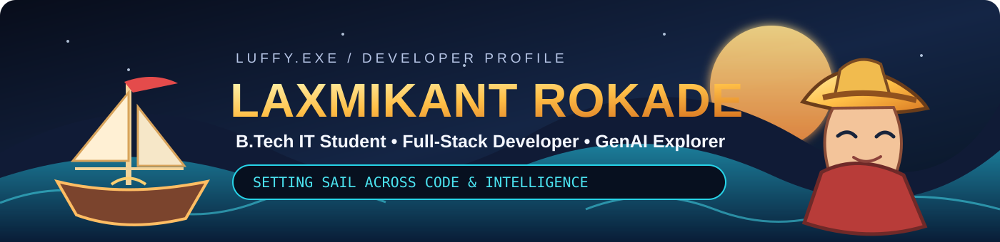

 

  
  
  
  

---

  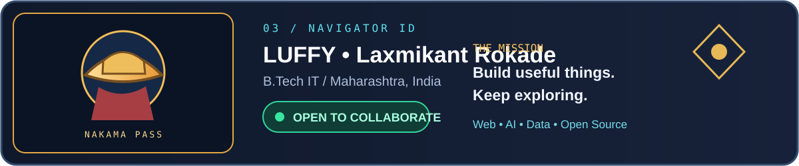

## 👒 Captain's Log

  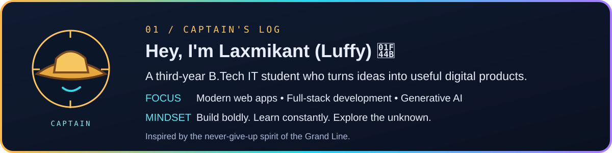

## ⚙️ Tech Arsenal

  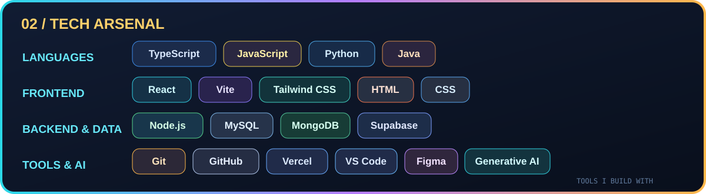

---

## 🚀 S-Rank Missions — Featured Projects

  Real builds, real repositories, and live demos where available.

<table border="0" width="100%" cellpadding="12" cellspacing="8">
  <tr>
    <td width="50%" valign="top">
      <a href="https://github.com/LaxmikantRokade/CarbonWiseAI">
        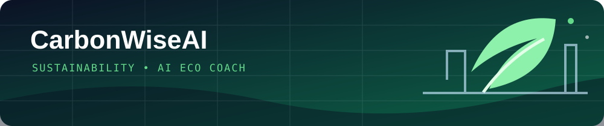
      </a>
      <h3>🌱 CarbonWiseAI</h3>
      
AI-powered sustainability platform to calculate and track carbon footprint.

      

        
        
        
        
      

      
Carbon calculator · AI Eco Coach · Emission tracker · Sustainability goals · Simulator · PDF reports

      
      
    </td>
    <td width="50%" valign="top">
      <a href="https://github.com/LaxmikantRokade/AgriSat-AI">
        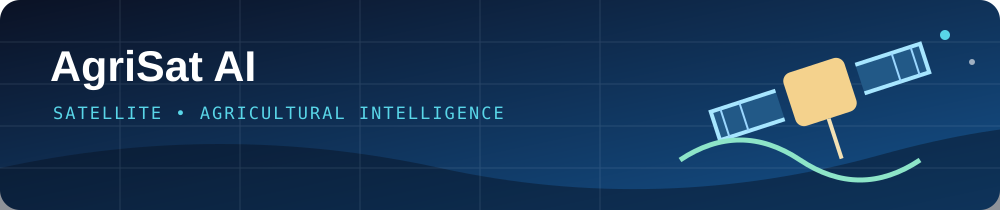
      </a>
      <h3>🛰️ AgriSat AI</h3>
      
Satellite-based agricultural intelligence concept for crop and field insights.

      

        
        
        
      

      
Satellite imagery · Agricultural intelligence · Crop and field insights

      
      
No public live demo listed.

    </td>
  </tr>
  <tr>
    <td width="50%" valign="top">
      <a href="https://github.com/LaxmikantRokade/MindCare">
        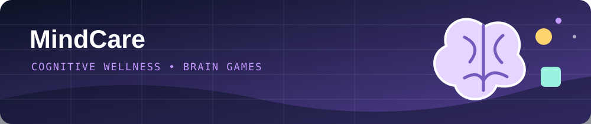
      </a>
      <h3>🧠 MindCare</h3>
      
Gamified cognitive wellness platform with daily mental activities and caregiver-oriented support.

      

        
        
        
      

      
Six brain-game experiences · XP and levels · Achievements · Daily quests

      
      
    </td>
    <td width="50%" valign="top">
      <a href="https://github.com/LaxmikantRokade/StudentAI">
        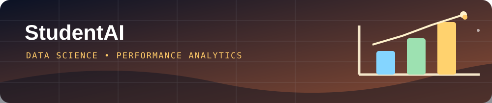
      </a>
      <h3>📊 StudentAI</h3>
      
Student performance prediction and analytics dashboard using the UCI Student Performance dataset.

      

        
        
        
      

      
Preprocessing pipeline · Regression models · Interactive analytics · Grade prediction

      
      
    </td>
  </tr>
  <tr>
    <td width="50%" valign="top">
      <a href="https://github.com/LaxmikantRokade/laxmikant-portfolio">
        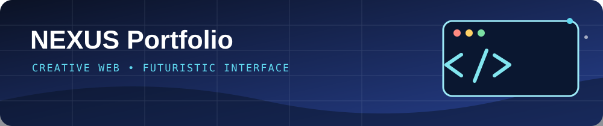
      </a>
      <h3>🧬 NEXUS — Creative Portfolio</h3>
      
A futuristic glassmorphic web portfolio with interactive sections and a sci-fi visual direction.

      

        
        
        
      

      
    </td>
    <td width="50%" valign="top">
      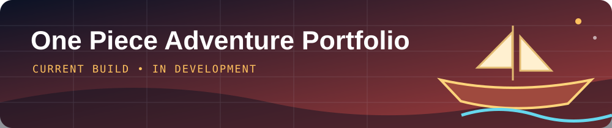
      <h3>☠️ One Piece Adventure Portfolio</h3>
      
A personal developer portfolio inspired by the Grand Line, built around an anime-adventure visual identity.

      

        
        
        
        
      

      
      
Repository and live demo are not published yet.

    </td>
  </tr>
</table>

---

  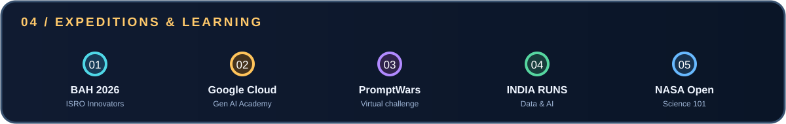

## 🏆 Expeditions & Learning

| Expedition | Focus / Context |
|:--|:--|
| 🛰️ **Bharatiya Antariksh Hackathon 2026** | Team ISRO Innovators |
| ☁️ **Google Cloud Gen AI Academy APAC** | Cohort 2 |
| ⚡ **PromptWars — Virtual** | Generative AI prompt challenge |
| 📊 **INDIA RUNS Data AI Challenge** | AI-powered candidate ranking project |
| 🌌 **NASA Open Science 101** | **Accepted & Enrolled** — Open Science Trainings |

  
  

---

## 📊 Developer Telemetry

  
  

  

### 🐍 Contribution Voyage

  
  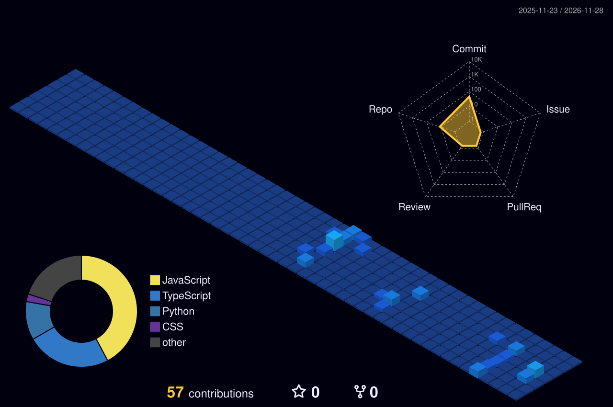

---

## 🎯 2026 Logbook

| Current focus | Next mission |
|:--|:--|
| Building and shipping practical web & AI projects | Grow open-source contributions |
| Exploring Generative AI and applied data workflows | Complete more advanced learning tracks |
| Participating in hackathons and learning programs | Prepare for software engineering internships |

  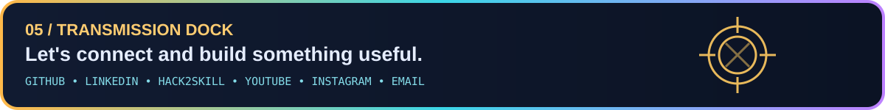
    
  
  
  
  
  
  

  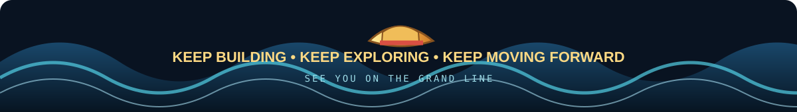
  ☠️ Laxmikant Rokade (Luffy) · Building one useful thing at a time.

